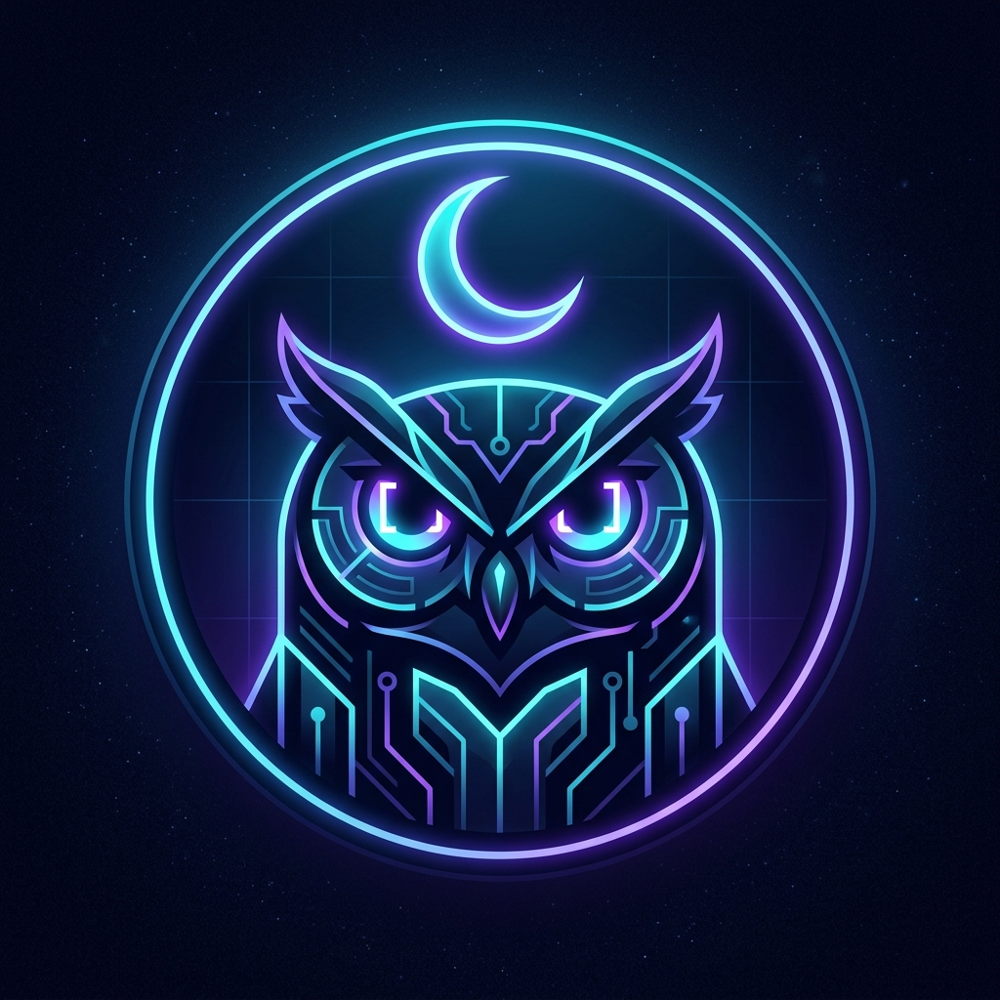
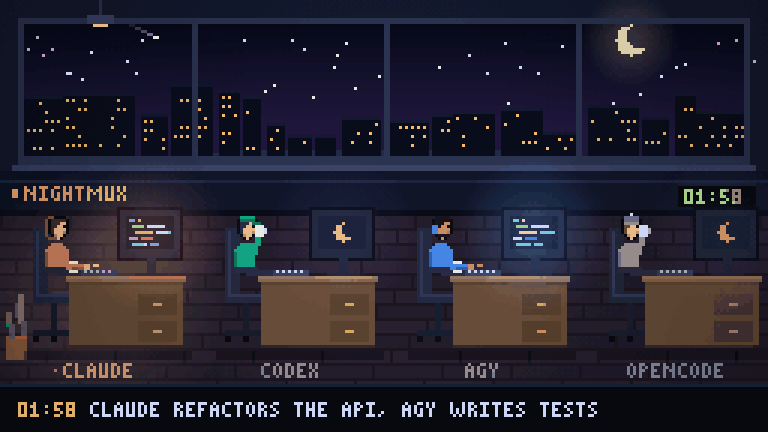

<div align="center">



# 🌙 nightmux

**Run Claude Code, Codex and Gemini overnight. When one hits its usage limit, the next takes over — until your tests pass.**

[](https://github.com/mmr710/nightmux/stargazers)
[](https://pypi.org/project/nightmux/)
[](https://github.com/mmr710/nightmux/actions/workflows/test.yml)
[](https://github.com/mmr710/nightmux/blob/main/pyproject.toml)
[](https://github.com/mmr710/nightmux/blob/main/pyproject.toml)
[](https://github.com/mmr710/nightmux/blob/main/LICENSE)
[](https://t.me/+SGmmExdMHTQ3OWVk)

[Website](https://mmr710.github.io/nightmux/) · [Live Office Demo](https://mmr710.github.io/nightmux/office.html?demo) · [48s Video](https://mmr710.github.io/nightmux/#video) · [How It Compares](docs/COMPARE.md) · [Leaderboard](https://mmr710.github.io/nightmux/leaderboard.html) · [Guide](docs/GUIDE.md)

</div>

- **Your test command decides when it is done.** After each turn, `--until` runs your shell check (`npm test`, `pytest -q`, `cargo test`); if it fails, the failure output goes straight back to the agent as the next prompt (up to 20 turns, or `--max-turns`).
- **Another vendor's agent takes over mid-flight.** On a Claude Code usage-limit banner, any agent's exit, or a turn over an hour, nightmux writes a `.nightmux/HANDOFF.md` brief (the cut-off task, recent actions, `git status`, diffstat and recent commits) and starts the next agent on the same working tree.
- **Nothing to set up.** One Python stdlib file over `tmux` and your existing agent CLIs. No bot, no API keys, no relay, no daemon required:

```bash
uvx nightmux run "fix the failing tests" --until "npm test"
uvx nightmux run "add input validation" --until "pytest -q" --agents claude,codex,gemini --max-turns 10
```

```text
claude: turn 1 sent
claude: check failed (exit 1)
claude: turn 2 sent
claude: usage limit hit
wrote .nightmux/HANDOFF.md
codex: turn 3 sent
✅ pytest -q passed after 3 turns
```

<div align="center">

<br><sub>A simulated night in the daemon's 3D / pixel-art office view (what the phone setup below adds; preview locally with <code>python3 nightmux.py --demo</code>). <a href="https://mmr710.github.io/nightmux/office.html?demo">Open live demo</a> · <a href="https://mmr710.github.io/nightmux/#video">Watch 48-second video</a></sub>
</div>

> **How `run` behaves:** Usage-limit banners are recognised for Claude Code directly; other agents fail over when they exit or a turn exceeds an hour. Permission dialogs in a pane are never auto-answered by `run` — it reports the session and waits for you to answer via `tmux attach -t =<session>`. Exit codes: `0` check passed, `1` max turns reached, `2` bad arguments or no tmux, `3` no agent left, `130` interrupted.

## See what your agents cost first

Before changing how you work, see what your agents already burned this month:

```bash
uvx nightmux wrapped              # 30-day report + two shareable cards (wrapped 7 for a week)
uvx nightmux wrapped 30 --json    # machine-readable JSON for scripts, badges and dashboards
uvx nightmux handoff codex        # write .nightmux/HANDOFF.md and continue this repo in Codex now
```

`wrapped` reads the local transcripts Claude Code, Codex, OpenCode and Antigravity already keep in your home directory and calculates what those tokens would cost at public API list prices (a size comparison, not your subscription invoice). Nothing is uploaded. It also writes two card files in the current folder: a private one with project names and `nightmux-wrapped-share` with counts only, ready to post. [Details and custom model pricing in the guide](docs/GUIDE.md#what-did-your-agents-cost).

Using Claude Code? Add `/nightmux:wrapped` and `/nightmux:handoff` inside your session:
```text
/plugin marketplace add mmr710/nightmux
/plugin install nightmux@nightmux
```

**Why sequential failover instead of parallel agent swarms?** In our own benchmarks on the same task, multi-agent "teams" cost ~3× the tokens of a single agent. What actually ships code overnight without tripling spend is one agent at a time, a real `--until` test gate, and automatic failover when a usage window runs out.

## From your phone (the full night shift)

`run` drives one task in one terminal. For multiple projects, overnight queues, 5-hour window auto-resume, tap-button approvals and a morning briefing, install the daemon:

```bash
curl -fsSL https://raw.githubusercontent.com/mmr710/nightmux/main/install.sh | sh
```

- **Telegram (or Discord / Slack):** Setup creates your bot (scan the terminal QR, or paste a token from [@BotFather](https://t.me/BotFather)). One forum topic per project → one `tmux` session behind it that you can still `tmux attach` to anytime. Send `!new myproj ~/code/myproj`, then type. Permission prompts arrive as tap buttons.
- **Dashboard only, no Telegram:** Run `nightmux up` to start the web dashboard, chat PWA and live office at `http://127.0.0.1:9090` (`python3 nightmux.py --demo` previews a simulated night on `:8099` with no keys). Nothing is opened to the network; to pair a phone over [Tailscale](https://tailscale.com), run `tailscale serve --bg 9090` and tap **+ Pair phone**.

What the daemon adds on top of `run`:

| | |
|---|---|
| 🌙 **Overnight queues & auto-resume** | Reads Claude Code's reset clock at 02:14, holds your queue + the cut-off turn, and resumes at 04:11 (`!failover codex` hands it over immediately) · `!at 03:00` / `!every 4h` schedules · `!shift` step queues · morning briefing with a GIF reel |
| 🎯 **Test gates & autonomous planning** | `!goal npm test` is `--until` in chat · `!po <goal>` drafts a roadmap and spins up isolated git worktrees · `!brain <mission>` nudges multi-step tasks and stops to ask when stuck · `!race claude,codex` compares two agents in parallel worktrees |
| 👀 **Kanban, diffs & 3D/2D office** | `/board` (`!kanban`) live session columns · `/review/<topic>` (`!review`) per-file diff + PR status · `/office` 3D & pixel-art office · `!undo` per-turn git checkpoints · [Android APK](https://github.com/mmr710/nightmux/releases/latest/download/nightmux.apk) with push alerts and home-screen widget |
| 💸 **Token & budget guardrails** | Live context % and 5h/weekly windows · auto-compact · `!tokens`, `!cost` and `!stats` · `!budget $20` spend caps · `!stopall` emergency brake · multi-server Tailscale peers (`--join`) |

`!help` lists all commands in chat ([full reference in `docs/COMMANDS.md`](docs/COMMANDS.md)). Docker, cloud-init VPS and manual setup: [install guide](docs/GUIDE.md#install).

## Agents

Any terminal coding agent works: nightmux types into its `tmux` pane and reads the screen back.

| Agent | Dialogs it turns into buttons | Usage windows | Tokens and cost | Started every night in CI |
|---|---|---|---|---|
| Claude Code | permissions, menus, folder trust | 5-hour and weekly | ✓ | ✓ |
| Codex | menus | 5-hour and weekly | ✓ | ✓ |
| agy | permissions | ✓ | ✓ | – |
| OpenCode | questions | – | ✓ | ✓ |
| Gemini CLI | folder trust | – | – | ✓ |
| Aider | (Y)es/(N)o questions | – | – | ✓ |
| Qwen Code | not yet | – | – | ✓ |
| Cursor, Amp, Goose | not tested | – | – | – |

The last column is the [drift guard](https://github.com/mmr710/nightmux/actions/workflows/drift-guard.yml): every night CI installs the newest release of each agent and verifies how nightmux classifies its initial screen.

## Security

**The bot token is a shell on your machine, and `allow_users` is the only thing between a stranger and your sessions.**

- **Local by default:** The dashboard binds `127.0.0.1` only; non-localhost access requires pairing (`nm_auth` cookie) and `X-Nightmux` CSRF headers.
- **Strict allowlist:** Messages from anyone not in `allow_users` are ignored.
- **Human-gated risky actions:** `!autoyes` is off unless enabled per topic (capped at 25/hr) and never approves `rm -rf`, `sudo`, `git push`, `curl | sh`, `--force` or `npm publish` (`!policy` customises this). `!sandbox on` (`--nm-sandbox`) isolates the agent in a rootless Docker container scoped to its project folder.
- **Zero dependencies:** Python 3.8–3.13 standard library only — nothing third-party in your supply chain. The optional QR setup shortcut passes the new bot token once through the maintainer's in-memory relay; paste a [@BotFather](https://t.me/BotFather) token directly if you prefer zero external hops. Read [SECURITY.md](SECURITY.md) before adding a second user or machine.

## More

[Guide](docs/GUIDE.md) · [Commands](docs/COMMANDS.md) · [How it compares](docs/COMPARE.md) · [Architecture](ARCHITECTURE.md) · [Cookbook](cookbook/README.md) · [Changelog](CHANGELOG.md) · [Contributing](CONTRIBUTING.md) · [Roadmap](ROADMAP.md) · [Website](https://mmr710.github.io/nightmux/) · [Telegram community](https://t.me/+SGmmExdMHTQ3OWVk) · [Donate](docs/GUIDE.md#-donate-crypto-usdt-on-trx-network)

MIT License · Python 3.8+, `tmux`, and any terminal coding agent. **If nightmux saved your night, a [⭐ star on GitHub](https://github.com/mmr710/nightmux/stargazers) helps other builders find it.**
