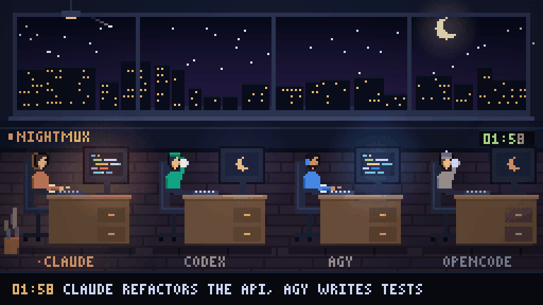

# nightmux guide

The long version. Start with the [README](../README.md); every command is in [COMMANDS.md](COMMANDS.md).

## Why this one

There are plenty of ways to reach a coding agent from a phone. Most are one of
two shapes: a bot that drives the agent through its SDK and keeps the
conversation in its own database, or a mobile app that talks to a relay service
you don't run. Both work. Neither leaves you with a terminal session.

nightmux is the third shape — it drives the session you would have started
yourself:

**It works the hours you don't.** A status-line sidecar gives nightmux the real
context percentage and the real 5-hour / 7-day limit windows, so it can act on
them instead of discovering them:

- a turn the limit cut off **resumes itself** when the window reopens
  (`"auto_continue": false` to wait for a human instead)
- a prompt sent during a lockout is **held**, not lost — replayed when the window
  resets, surviving daemon restarts and reboots
- a prompt refused before it ever got a turn goes back on the queue whole
- `!at 03:00 <prompt>` and `!every 4h <prompt>` start work while you are asleep —
  and they queue rather than type, so they wait behind a lockout too
- `/compact` automatically at a context threshold you set (`!autocompact 70`)
- warnings at 80% and 90% of a window, before the wall rather than at it
- `!ctx` shows what is actually filling the window; `!cost` weighs a session or
  every project by token type

Long-running agent sessions cost money and stall in ways chat never does. That is
what nightmux watches for.

**It attaches to sessions instead of owning them.** nightmux types into tmux. The
session is still yours — SSH in, attach, type directly, and the bot keeps working
mid-conversation. Nothing is wrapped, proxied, or re-hosted, so there is no state
to get out of sync and nothing to lose when the daemon restarts.

**It is not tied to one agent.** `!new` starts your default; `!codex`, `!agy`,
`!opencode`, `!gemini`, `!aider`, `!cursor` (Cursor CLI), `!amp`, `!goose`,
`!qwen` (Qwen Code) or anything you add to `agents` in the config starts that instead, and
`!resume` remembers which agent a topic belongs to. The hooks and the usage
numbers are Claude Code specific — every other agent degrades to reading the
terminal, which is how nightmux worked before the hooks existed.

**One topic, several agents.** A bare `!agy`, `!codex` or `!opencode` in a topic
that already has a directory switches *that topic* to that agent — same project,
its own tmux session, and the agent you were on left running. `!agents` lists the
bench and marks the live one; switching back lands in the conversation it was in,
not a fresh one. Give a name and a directory (`!agy side ~/code/api`) and it
still means start-a-new-session, as before.

One session belongs to one topic. Two topics pointing at the same session share a
single scrape cursor, so whichever one the watcher reaches first gets the output
and the other goes quiet; `!bind` refuses that now, and `!status` flags any pair
already in your config.

**Not for you if** you want a polished app instead of a chat window, you're on
Windows ([#2](https://github.com/mmr710/nightmux/issues/2) — macOS and Linux
both install as a service), or you want your
teammates in the same group: the allowlist is a list of people trusted with a
shell on your machine, which is not a thing to hand out. One person, their own
box, their own agents.

## Several agents, one project

`!new api ~/code/api @refactor-auth` checks out a git worktree for that branch —
new if it doesn't exist, reused if it does — at `~/code/api-wt/refactor-auth`,
and starts the session there instead of in the main tree. Two agents, two
branches, no stepping on each other's uncommitted work. `!worktrees` lists every
worktree of the current topic's repo and which session (if any) is sitting in
it. Nothing here routes work between agents or merges anything — that part is
still yours; this is just isolation.

## Consulting two agents at once

`!consult <question>` puts the same question to every agent on the topic's
bench, separately. Round one goes out blind — showing each of them the other's
answer first gets agreement, and agreement between two models that read each
other is worth much less than two independent reads. Round two hands each one
what the other said and asks for a single self-contained prompt, fenced.

What comes back is one message per prompt, or one message if they converged on
the same wording. The drafts in between are not posted: they are working notes,
and both of them arrive in the report anyway.

```
!consult should the parser stream or buffer?
🤝 consult round 1 — asking agy, claude, separately
🤝 consult round 2 — each now reads the other
🤝 consult done — agy, claude
   they differ; both are below, yours to pick
```

What comes back carries a button. `!use` — or a tap on **run it** — sends that
prompt into the agent this topic is on, so the answer to "what should I ask for"
becomes the thing being asked without anyone retyping it on a phone. When the two
disagree you get one button each, and `!use agy` / `!use claude` pick between
them.

A consultation lives in memory only. Restarting the daemon cancels it, on
purpose: half a conversation restored into two sessions that have since moved
on is worse than none.

## Command center

`!center` in any topic makes it the one place that watches and controls every
session — it binds to nothing itself, `!board` there shows every topic's state
at a glance:

```
you   !board
bot   ✅ api      topic 12   idle    2s quiet  5h 40%  ctx 22%
      ⚙️  web      topic 15   busy    0s quiet  5h 40%
      🟠 scratch  topic 19   waiting 1s quiet  🔒held→04:11
      spend  api ~12,400tok · web ~3,100tok
```

Approvals mirror there too: a session's 🟠 needs-input prompt posts to its own
topic as always, and a copy lands in the command center with the same buttons.
Whichever is tapped first answers the pane; the other loses its buttons
immediately rather than sitting there able to send a second, conflicting
keystroke. `!all web,scratch --continue` (or `!all --all <prompt>` for every
bound, writable session) sends the same prompt to several sessions at once —
it replies with exactly who it is about to hit before anything is typed, and a
`"readonly"` topic is never one of them. Nothing here routes work between
agents or decides anything for them; it broadcasts and it aggregates, and every
session still runs on its own.

## Snapshots and !undo

Before nightmux sends a prompt it typed without you watching it happen — a
prompt held for a usage-limit reset, an `!at`/`!every` firing, a `!shift`
step — it takes a git snapshot of the session's cwd first: `git stash create`
captures the worktree without touching it, and a `nightmux/pre-<UTC timestamp>`
branch is left pointing at it (the last 5 per repo; older ones are dropped).
Prompts you type live get no snapshot — there is nothing unattended about them.
`!undo` lists a topic's snapshot branches, newest first, with the exact `git
restore`/`git diff` commands to look at or roll back to one. It never runs them
— a phone is a small thing to fat-finger a hard reset from.

## Zero-Dependency Webhook API + Dashboard

nightmux runs a local HTTP server (`127.0.0.1:9090`) to accept commands from outside Telegram. You can configure `"webhook_port": 9090` in your `~/.nightmux.json` to enable it.

This turns nightmux into the central nervous system for your local agents. You can pipe GitHub Actions test failures or VS Code compiler errors straight into your agent's queue while you sleep.

```bash
curl -X POST http://127.0.0.1:9090/topic/api -d "review the staged changes"
```

The same port also serves a page — open `http://127.0.0.1:9090/` for every
bound topic at a glance (mode, usage, who else is on the bench) with a box
to send a prompt, no phone required. `/api/topics` is the JSON it polls, if
you want to build your own view instead.

Check out the [Cookbook](../cookbook/README.md) for copy-paste recipes for GitHub Actions and editor integrations.

## From idea to running project

In a new topic: `!idea a habit tracker with streaks and a weekly chart`
(`!idea @codex …` to pick the agent). nightmux makes a fresh folder under
`projects_root`, runs `git init`, starts the agent with one queued brief —
write SPEC.md, build the smallest useful version, add a `./check.sh` that
runs the tests — and turns on `!goal sh ./check.sh`, so it keeps going until
its own check passes. `!preview` when it serves something, `!p ship` when you
like it.

Saved prompts: `!p` shows `review`, `fix-tests`, `spec`, `explain`, `tidy`
and `ship` as buttons; `!p save <name> <text>` adds yours (`{{args}}` marks
where `!p <name> <args>` puts the rest).

## Previews and production errors

**Deploy previews:** while `!watch` follows a PR, the preview URL your host
attaches to its commit — a GitHub deployment (Vercel, Render…), a
`deploy-preview` status (Netlify) or a link in a bot's comment (Cloudflare
Pages, Netlify) — is posted once per commit with 🔗 open and 📸 screenshot
(`!shot last`); a photo after that is a point-and-fix report about the
preview. Bot comments are no longer sent to the agent as review feedback.

**Errors:** `!errors` in a topic gives it a webhook,
`https://<host>:8443/hook/<topic>?key=…`. Point a Sentry custom (internal)
integration's alert action at it — or POST any JSON `{title, stack, url}` —
and each new error (deduplicated for 6 hours) arrives as 🚨 with a **fix it**
button; `!errors auto` sends it straight to the agent: reproduce with a
failing test, fix, push. Sentry is on the internet, so `!errors expose` (you
run it) publishes only `/hook`, on port 8443, with Tailscale Funnel — the
dashboard stays tailnet-only and the hook refuses anything without the key.
`!errors unexpose` takes it back off the internet.

## Issues in, pull requests out

`!issues` lists the repo's open issues as buttons. Tap one (or
`!issue 12`): the agent gets the issue and its comments, a branch name
(`issue-12-…`) and the recipe — branch, fix with a test that fails first,
push, `gh pr create` ending in `Fixes #12`. nightmux watches for that
branch's PR and, once it opens, `!watch` takes over: CI failures and review
comments go back to the agent, green gets a merge button.
`!issues auto` (label `nightmux`, or `!issues auto <label>`) works through
labelled issues one at a time whenever the topic has been quiet 10 minutes
with nothing in flight — label a few before bed. `!issues auto off` stops.

## Close the PR loop

`!watch pr` (this branch's PR) or `!watch pr 12`: nightmux polls it with `gh`.
A failed check's log goes to the agent — fix, commit, push. New review
comments, inline ones included, go to the agent too; comments made by your
own gh account are skipped so an agent replying on the PR never feeds itself.
When every check is green you get one 🟢 with a **merge** button. Merged or
closed ends the watch.

## Android, on your phone

`!apk` builds the project's debug APK — a Gradle wrapper at the root or
under `android/` (React Native, Capacitor), or Flutter — and sends it to the
topic: tap to install. With your phone on wireless debugging (Developer
options → Wireless debugging, reachable over the tailnet or Wi-Fi):
`!android pair <ip:port> <code>` once, `!android connect <ip:port>`, then
`!apk install` builds and installs in one go, and `!shot android` sends the
phone's screen. A photo sent after that is a bug report: the agent gets it
with the activity on screen and recent logcat errors. A failed build has a
**send to agent** button. nightmux uses the first `adb` on PATH that actually
runs (an SDK's x86 adb on an ARM server does not; `apt install adb`).

## A desktop for agents

`!desktop` starts a virtual screen on the server (Xvfb + openbox), and gives
you a 🖥 button: noVNC over your tailnet, behind a VNC password, to watch or
take over from the phone. `!tools add desktop` gives the topic's agent
nightmux's own MCP server for it — `screenshot`, `click`, `type`, `key`,
`scroll`, `open` — so it can drive GUI apps, a real browser with a login, an
emulator. `!desktop open <app>` starts something yourself, `!desktop shot`
sends a screenshot, `!desktop off` stops it all. Needs `xvfb openbox x11vnc
novnc websockify xdotool imagemagick` (apt).

## Give the agent a browser

`!tools add browser` registers Playwright's MCP server with the topic's
live agent through its own CLI (`claude mcp add -s local` — this project
only — or `codex` / `agy` / `opencode mcp add`); `!tools add browser all`
does every agent on the bench. Tap **restart** (or `!tools restart`) so the
agent loads it, and it is told to use it: open the running app, click
through what it changed, read the console, before it says done. Headless,
sandbox-off for servers, and it reuses the Chromium nightmux already found
(Playwright's, or `"browser"` in the config). `!tools rm browser` removes it.

## See it on your phone

`!preview` finds the dev server the agent started (from the session's own
process tree) and replies with a 📱 button per app. A server on all
interfaces is linked on your tailnet directly; one on `127.0.0.1` gets a
`tailscale serve` on the same port. Nothing is exposed to the internet.
`!shot` sends a phone-size screenshot of it (`!shot :5173/settings`, or any
URL) — uses Playwright's Chromium if present, else the system's, or
`"browser"` in the config.

**Point and fix:** within two hours of a `!preview` or `!shot`, a photo you
send to the topic — a screenshot with the bug circled, captioned or not — is
treated as a bug report about that page. The agent gets the image, the page
URL, that page's console errors and its rendered DOM (as a file), and is told
to find the code behind what is marked, fix it, and load the page again.

## The right agent for the task

`!route auto` in a topic with several agents on its bench: a prompt that
starts a new task (the topic has been quiet 10 minutes, no `!goal` loop
running) is sorted light (rename, typo, add tests, docs), heavy (design,
debug, why, refactor, performance, security) or normal, and the topic
switches to the best live agent for it — `↪️ → codex (light task)`. Mid-task
prompts never move. `!goal` results teach it which agent actually finishes
which kind of task; `"route_prefs"` in the config sets the starting order.
`@agent <prompt>` still overrides; `!route off` stops it.

## The night, as a GIF

nightmux records the office's desks once a minute (only when something
changes). `!reel` (last 12h; `!reel 8` for 8) replays the busiest room as a
GIF — drawn by the office page itself in headless Chromium, stitched by a
small stdlib GIF encoder — captioned with what happened ("claude hits its
limit, codex gets to work") and each project's commits and lines changed.
`!reel daily 07:30` sends it every morning; `!reel off` stops that.

## A second pair of eyes

`!pair codex` in a Claude topic (any two agents): after every turn that
changed the tree, the reviewer — started on the topic's bench if it is not
running, never switched to — runs `git diff <since>` in the same folder and
reports only real problems as `file:line — problem — fix`, or `LGTM`. LGTM is
a quiet 👍; findings go straight back to the coder, at most 2 rounds per
change (`!pair codex 4` for more) before it hands the disagreement to you.
`!pair off` ends it.

## When an agent goes in circles

Every finished turn leaves a few cheap readings: error lines, which files
changed against HEAD, apologies. Two independent signs of circling in the
recent turns — the same error 3×, one file edited 4+ turns while the diff
does not grow, repeated "I apologize / let me try another approach", the
`!goal` check failing the same way — and you get **🌀 looks stuck** with
buttons: 🧠 step back (list hypotheses before editing), 🔀 hand to another
agent with a summary, ⏸ pause. `!loopguard auto` lets the first one step it
back by itself; `!loopguard off` disables it.

## Morning briefing

`!briefing 07:30` in any topic: every morning at that time, one message
there — what got done overnight (commits and lines per project), what is
waiting for you (agents asking a question, open PRs with GitHub's verdict:
ready, behind, conflicting; production errors from `!errors`), each usage
window and when it fills at the current pace, and what is queued, held or
stopped. Buttons open the night reel and yesterday's stats. `!briefing now`
for one right away, `!briefing off` to stop.

## Dependency health

`!deps` runs the project's own tools — `npm audit` / `npm outdated`,
`pip-audit`, `govulncheck`, whichever apply and are installed — and lists
known vulnerabilities worst first and packages a major version behind, with
one **🛠 upgrade with agent** button: fixes first, majors one at a time with
their changelogs, tests after each, one commit each (your `!goal` check, if
set, holds it to green). `!deps nightly 04:00` checks every night and only
speaks when it finds something; `!deps nightly off` stops it.

## See the limit coming

Every usage window an agent reports (Claude's 5h/7d, Codex's) is sampled
once a minute. At the last hour's pace, if one will be full before it
resets — and within 90 minutes — the topics working on that agent get one
⏳ warning ("claude will hit its 5h limit around 03:10 at this pace, 82% now,
+14%/h") with a button to switch to another agent while there is still time.
`!forecast` shows every window; the dashboard's limit cards show the
projected time too.

## Project memory

Each project keeps `.nightmux/memory.md` — what it is, how to run and test
it, decisions and why, gotchas, what is in progress. After six finished
turns and 15 quiet minutes the live agent rewrites it (that exchange is not
posted, just a quiet 🧠), and every session nightmux starts or switches to in
the topic is told to read it first — so a fresh agent, a failover or a switch
does not start from zero, and you stop re-explaining. It is kept out of git
through `.git/info/exclude`. `!memory` shows it, `!memory update` refreshes
it now, `!memory off` stops it for the topic.

## Spend fewer tokens per task

Every turn re-reads the whole context, so the savings are in turns that
never happen and contexts that stay small.

- **Auto-compact is on by default** at 200k tokens on Claude Code sessions
  (`!autocompact 150k|70|off`).
- **Fresh session per task** — once `!goal` goes green and the thread is past
  60k tokens, the agent writes its notes to project memory, then `/clear`
  (`/new` on codex/opencode) and re-reads them. `!fresh now` does it on
  request; `!fresh off` keeps threads.
- **Prompt lint** — "fix it", "still broken" are held for one tap: ✨ improve
  rewrites it with Claude Haiku in the style of your own prompts that landed
  first try, adding the error on the agent's screen and the `!goal` check as
  the done-condition; or send as is. `!lint off` turns it off.
- **Corrections are counted** — "no", "still same", "not working"… mark the
  previous task as missed. `!coach` shows what your first-try prompts have in
  common; `!route stats` shows the first-try rate per agent and task class,
  and auto routing (`!route auto`) uses it once an agent has 5 tasks in a class.
- **Model ladder** (`!ladder on`) — Claude takes light tasks on haiku, normal
  on sonnet, heavy on opus, and steps up one model when `!goal` fails the
  same way twice, the loop guard fires, or you correct it twice. It never
  drops to haiku on a context over 120k.
- **Switches only when they are cheap** — the prompt cache belongs to one
  model and one agent, so a switch re-reads the whole thread uncached. The
  ladder and `!route auto` change model or agent only when the thread is under
  30k tokens (a new task, after `!fresh`); the one exception is a step up when
  the agent is struggling, at most once per task. `!route stats` shows what
  the switches cost.

## Keep going until it passes

`!goal npm test` (or `pytest -q`, `npm run build`, anything with an exit code)
makes the topic's agent prove it is done: after every finished turn nightmux
runs the check in the project folder. Red, and the last 40 lines go back to
the agent as its next prompt — fix the cause, don't touch the test. Green, and
you get one ✅. The same failure three times in a row, or 6 rounds
(`!goal 10 npm test` for more), and it stops and shows you instead of burning
the night. Your next message resumes it; `!goal off` ends it.

## Two servers

One bot, one group, topics spread over several machines. On the dashboard,
**servers → + add server** shows four steps:

1. On the new machine: `sudo apt install -y tmux git python3`, then install
   Tailscale and `sudo tailscale up` into the same tailnet.
2. Install the agents you want there and sign each in once.
3. Paste the command the dashboard gives you — `nightmux.py --join <code>`.
   The code is good once, for 30 minutes. It fetches the bot settings and a
   fresh peer secret from this machine over the tailnet, writes the new
   machine's config as a peer, wires the Claude Code hooks and installs the
   service.
4. The new server appears on the dashboard. Pick it as the **server** in
   **+ new project**, or send `!server <name>` in a topic to move it there
   (`!server local` brings it back).

How it works: Telegram lets one process poll a bot, so this machine stays the
primary — it forwards each remote topic's messages to the peer that runs it,
and the peer replies to Telegram itself with the same token. Peers talk on a
listener that serves only `/peer/` routes, with the shared secret. The
dashboard and office show every machine's topics, metrics and limits;
**remove** on a server card forgets it (once its topics are moved or closed).

The **setup** panel at the top of the dashboard lists anything not yet set
up on this machine — bot rights, agents, tailnet access, `gh`, Chromium — each
with the command that fixes it (the same checks as `nightmux --doctor`).

## The dashboard

**💬 on every topic card** opens that topic as a chat: your messages, the
agents' answers, their menus as buttons that work, a box to type in, and a
"working…" line while the agent is busy. It reads new messages only, so the
page never jumps. Add the dashboard to your phone's home screen and it opens
like an app; 🔔 turns on notifications while it is open (closed-app push stays
Telegram's job). The chat keeps the last 300 messages per topic in memory —
Telegram keeps the full record.


**+ new project** opens a form: a name, an agent, a folder (defaults to
`projects_root/<name>`), a server when you have peers, and an optional idea.
It creates the Telegram topic, the folder and the session — with an idea, the
agent gets the spec → build → `./check.sh` brief and the `!goal` loop. On
every topic card: the live agent and the rest of its bench as chips (tap one
to make it live), **+ agent** to start another beside it, and **close**, which
stops the topic's agents, unbinds it and closes the Telegram topic — files
are never deleted. The bot needs the *Manage topics* admin right to create
and close topics. These actions require an `X-Nightmux` header, so another
website you visit cannot trigger them.


`http://127.0.0.1:<webhook_port>/` (or over `tailscale serve`) shows server
metrics, limits per agent, every topic with a send box, and a **chat
analysis**: per agent, how many prompts, model calls and tokens you spent,
the cache hit rate, the average context each call carried, how often you
nudged with "continue"/"yes" — and what to change to get better output for
fewer tokens. The same report is `!stats [days]` in Telegram.

## Share it

- `!saved` — what nightmux did for you, counted: tokens of context not
  re-read after compactions and fresh starts, turns worked between midnight
  and 7, queues resumed after limits, hand-offs, green checks, loops caught.
- `!wrapped [days]` — the same as a 1200×675 card with your agent stats, and a
  🐦 button that opens a ready-to-post tweet. `nightmux wrapped [days]` draws it
  from the shell with no bot or config, and adds what the tokens would cost at
  API list prices; `"prices"` in `~/.nightmux.json` adds a model's rates.
- The night reel is signed with the repo link and gets the same 🐦 button.
- `!public on` — a read-only office at `/public/<token>`: agent states only,
  no screen text, prompts or buttons. Tailnet-only until `!public expose`,
  which puts just that path on the internet with Tailscale Funnel.
  `!public off` kills the link.

## Night QA

`!qa 03:00 http://localhost:3000` — every night the agent opens the app with
the browser tool (added for you), uses it like a new user, and files each real
bug as a GitHub issue labelled `qa`, with steps to reproduce. It does not touch
the code; `!issues` picks the fixes up in the morning. `!qa now`, `!qa off`.

## Leaderboard

`!leaderboard` shows the counts it would share — turns, night turns, limits
survived, green checks, tokens saved, which agents; no project names, prompts
or code. `!leaderboard post` adds them as a comment on the
[leaderboard issue](https://github.com/mmr710/nightmux/issues/54) with your own
`gh` login, and [the board](https://mmr710.github.io/nightmux/leaderboard.html)
ranks the crews. Nothing is sent without the `post`.

## Race agents on one task

`!race claude,codex add rate limiting to the login endpoint` gives the same
task to each agent, each in its own git worktree from your current commit (so
nobody edits anybody else's files). When they are done you get one card: what
each changed, whether your `!goal` check passes in its tree, how long it took —
and a 🏆 button per agent. The winner's changes land staged in your folder;
the other worktrees are deleted. `!race diff codex` shows one's diff first,
`!race cancel` drops it all. Without a list it races the topic's bench (or
the first two agents installed).

## Voice notes

Send a voice note and, with a transcriber configured, the agent gets the
words (shown back to you as 🎙 so you can check them). You choose where your
voice goes — any command that takes the audio path last and prints text:

```json
"transcribe_cmd": "sh -c 'ffmpeg -loglevel quiet -y -i \"$0\" -ar 16000 /tmp/nm.wav && whisper-cli -m ~/models/ggml-base.en.bin -nt -np -f /tmp/nm.wav'"
```

(whisper.cpp, fully local.) Without one, the agent gets the audio file's path.

## Without Telegram

No bot? Press Enter at the token prompt in `nightmux --setup` (or leave
`token` out of `~/.nightmux.json`). nightmux runs dashboard-only: the
dashboard at http://127.0.0.1:9090/ opens projects with **+ project**, and each
project's 💬 chat view (an installable PWA) is the channel — the same commands,
buttons and replies you would get in a Telegram topic. Add a bot later by
running `--setup` again.

`nightmux up` is the short way in: it checks for tmux, will not start a second
copy when the port is taken, and starts dashboard-only. The dashboard listens
on this machine only. For a phone, run `tailscale serve --bg 9090` (Tailscale
on both devices) and press **+ Pair phone**; until there is a route, the
terminal prints that command instead of a QR that could not connect.

## The office

`/office` on the same port is your night crew as a pixel-art office: a room
per topic, a desk per agent on its bench, every animation a real state —
typing while it works (and what it's doing), hand up when it's asking (with
the menu's real options as buttons), asleep with a countdown on a usage limit
(with one-tap hand-off to another agent), an empty chair when its session is
gone, sticky notes for queued prompts. Tap an agent to answer it, prompt it,
or fail it over. Screen text is redacted before it leaves the machine.

Each agent has its own look — claude's hood, codex's cap, agy's headset,
opencode's beanie — and the monitor shows what kind of work it is: code
scrolling, a yes/no dialog, a limit bar, static. A finished turn sparkles; a
hand-off flies a folder from one desk to the next. Every room has a lounge:
idle agents get up and wander to the coffee machine, the TV or the toilet
and come back; one that hit its usage limit goes to bed until the window
resets. Two agents on a break at the same time get talking, and a hand-off
comes with a "yours" / "got it". The window follows your clock: stars and a
moon at night, sunrise from 5, daylight from 7, dusk until 21
(`/office?hour=14` previews). 🔈 turns on sounds for a finished turn, a
question and a limit. Tap an agent for its last 24 terminal lines, live.
`/office?demo` plays the night shift above on a loop, no server state needed.

To open it from your phone without opening a port to the internet, put it on
your tailnet:

```bash
tailscale serve --bg 9090          # https://<machine>.<tailnet>.ts.net
```

then `"office_url": "https://<machine>.<tailnet>.ts.net/office"` in the
config, and `!office` posts it as a button in Telegram.

## The Android app

The office, chat and dashboard in a native app, plus what a browser tab can't
do: alerts, answering from the notification, a home-screen widget.

- **Pair:** open `/app` on the dashboard (📱 **app** in its header). On a
  computer it shows a QR code; scan it with the phone's camera, tap **Open in
  app**, confirm. No URL typing. Or download
  [`nightmux.apk`](https://github.com/mmr710/nightmux/releases/latest/download/nightmux.apk)
  from the latest release and enter the address by hand.
- **Alerts** (opt-in, ⚙): ✅ an agent finished, 🛑 it hit its usage limit
  (with when it's back), ⏸ it needs you, with the menu's first three choices
  as buttons on the notification. Answering needs the phone unlocked.
- **Widget:** a tile per agent, room by room, colored by state. Live while
  alerts are on, every 30 minutes otherwise.
- **☾ ambient:** the office full screen, landscape, screen kept on. An old
  phone on the desk becomes a window into the night shift.
- **Several servers:** ⚙ lists them; tap one to switch, add or forget.
  Alerts and the widget follow the one on screen.
- Pinch to zoom the office. Voice notes and file attachments work in chat;
  links to GitHub, X or Telegram open in their apps.

The app talks to the daemon the way the pages do, over your tailnet or LAN.
nightmux has no login of its own, so don't put the dashboard on the open
internet for it. Alerts poll every 15 seconds while on (there is no push
route into a tailnet); turn them off and the app uses nothing in the
background. Android 11+.

Build it yourself with `gradle -p android assembleRelease` (Gradle 8.11,
JDK 17, Android SDK 35). Store listing text and screenshots live in
`fastlane/metadata/android/`, the layout F-Droid and Play both read.

## Plugins

Drop an executable file in `~/.nightmux-plugins/`; its filename becomes a
command. `!weather` runs `~/.nightmux-plugins/weather`, its argument as
`$1`, and whatever it prints to stdout is the reply — the same shape as the
built-in `!git`/`!grep`. It never reaches a session's keyboard, so it works
in a read-only topic same as any other read command. `!plugins` lists
what's there.

## How it works

Four files, no framework:

| | |
|---|---|
| `nightmux.py` | the daemon: long-polls Telegram, watches tmux, everything above |
| `nightmux_state.py` | status-line sidecar — parks context %, limit windows and the transcript path where the daemon can read them |
| `nightmux_stop.py` | `Stop` hook — pushes the final answer as exact text, not scraped pixels |
| `nightmux_notify.py` | `Notification` hook — pushes permission prompts the instant they appear |

The daemon reads the session's JSONL transcript when the sidecar is installed,
which is why output arrives as clean text with a real tool trace. Without it,
nightmux falls back to scraping `tmux capture-pane` — everything still works, just
noisier and without the usage numbers.

A screen the classifier does not recognise is never guessed as idle — it is held
as `unknown` and treated like a busy pane: a prompt sent to it queues instead of
typing into a state nobody has confirmed is safe, with `!raw` to type it anyway.

One watcher thread polls every bound session; each topic gets its own worker
thread, so a slow command in one topic never blocks another. Within a tick, each
bound session's own tmux round-trips run in a small pool (up to 8 at once) so
one slow or hung session cannot stall every other session's update behind it.
The polling offset is only persisted past updates that have actually finished,
so a crash replays work rather than dropping it.

[ARCHITECTURE.md](../ARCHITECTURE.md) has the rest: threads, what survives a
restart, how output is chosen, and the decisions that were rejected.

Run the tests: `python3 nightmux.py --selfcheck` (and the same flag on the three
hook scripts). No framework, no fixtures — asserts that fail loudly.

`nightmux --doctor` triages an install without fixing anything: tmux found,
config complete, token accepted by Telegram, hooks wired, service active — one
✓/✗ line each, exit 1 if anything is off.

`python3 tests/test_panes.py` runs the pane corpus: captured terminal screens and
the state nightmux must read from each. Adding an agent whose TUI it misreads is
one file — drop the pane in `tests/panes/` as `<what>.<busy|idle|waiting>.txt` and
the classifier is held to it from then on.

## Config

`~/.nightmux.json`, mode `0600`, written by setup:

```json
{
  "token": "<from @BotFather>",
  "chat_id": -1001234567890,
  "allow_users": [123456789],
  "topics": {"12": "api"},
  "agent": "claude",
  "agents": {"opencode": ["opencode", "--continue"]},
  "autostart": {"api": "~/code/api"},
  "auto_restore": false,
  "projects_root": "~/code",
  "tz_offset": "Africa/Cairo",
  "autocompact": 70,
  "auto_continue": "continue",
  "modes": {"115": "readonly"},
  "auto_update": "1d",
  "failover": "codex",
  "poll": 2
}
```

`agent` is what `!new` starts. `agents` adds or overrides entries in the
built-in table as `[command, resume-flags]` — those flags are the part most
likely to drift as these CLIs change, so they are config, not code.
`autostart` recreates named sessions after a reboot. For everything else a
reboot killed, nightmux checks each bound topic against tmux at startup: with
`auto_restore` it just relaunches and says so; without it, the topic gets a
"machine restarted?" message with a Restore button instead of nightmux acting
on its own — `!restore` does the same relaunch on demand. `projects_root` makes
a new topic named after a directory start that project on its first message.
`!reload` picks up hand edits without a restart.

`failover` names the agent a topic hands its held work to the moment its
agent hits a usage limit — the working tree and the cut-off instruction go to
`codex` (or whoever) instead of waiting hours for the reset. Without it, the
limit message offers the same thing as one-tap buttons; `!failover <agent>`
does it by hand. Without the bot, `nightmux handoff <agent>` does the same from
a terminal in the repo: it writes `.nightmux/HANDOFF.md` from the newest Claude
Code or Codex conversation there and the git state, and starts the agent on it.

`auto_update` (`true` = daily, or an interval like `"12h"`; off by default)
runs each installed agent's own updater on that schedule — `claude update`,
`codex update`, `agy update`, `opencode upgrade` — and posts what changed to
the command-center topic, or General. `!update [agent]` does it on demand.
`update_cmds` overrides or adds an agent's updater; `""` turns one off. It is
off by default because it runs installers unattended. Running sessions keep
their version until relaunched: `!kill yes`, then `!restore`.


## MCP server

`nightmux --mcp` is a stdio [MCP](https://modelcontextprotocol.io) server, so any MCP
client — Claude Desktop, Cursor, or an agent in another topic — can see and steer
your night crew. It talks to the running daemon on `127.0.0.1:<webhook_port>`, so
the daemon must be up with the dashboard on.

| tool | does |
|---|---|
| `list_topics` | every topic, its agent, state and queue |
| `read_terminal` | the last N lines of a topic's terminal |
| `read_chat` | the relayed conversation; `after` for only what's new |
| `send_prompt` | a prompt for the topic's agent, queued like one from your phone |

nightmux's own `!` commands are not exposed: an MCP client can prompt agents, not kill them.

```json
{ "mcpServers": { "nightmux": { "command": "nightmux", "args": ["--mcp"] } } }
```
(or `"command": "python3", "args": ["/path/to/nightmux.py", "--mcp"]` for a git checkout)

## Lights and Home Assistant

`!events <url>` POSTs one small JSON body per moment worth a glance:

```json
{"event": "needs_input", "topic": "5", "name": "shop", "session": "shop",
 "text": "Bash(git push origin main)", "ts": 1760000000}
```

`event` is `needs_input`, `done`, `limit`, `resumed` or `budget`; `text` is the first
line, redacted. `!events test` sends one now, `!events off` stops.

With Home Assistant, point it at a webhook trigger
(`!events http://homeassistant.local:8123/api/webhook/nightmux`) and turn a lamp amber
when an agent needs you:

```yaml
automation:
  - alias: nightmux needs me
    trigger: {platform: webhook, webhook_id: nightmux, local_only: true}
    condition: "{{ trigger.json.event == 'needs_input' }}"
    action:
      - service: light.turn_on
        target: {entity_id: light.desk}
        data: {color_name: orange, brightness_pct: 40}
```

## Discord and Slack (experimental)

The same model on other chat apps: a **Discord forum post** or a **Slack channel** is a
topic. Everything else — `!new`, buttons, the queue, limits — works the same, and you can
run them beside Telegram or instead of it (leave `token` out). Incoming messages arrive
over each app's websocket, so nothing needs a public URL.

Your id on that app must be in `allow_users`, like your Telegram id: a Discord user id
(Developer Mode → right-click your name → Copy User ID) or a Slack member id (`U…`, from
your profile → ⋮ → Copy member ID).

**Discord.** Create an application at <https://discord.com/developers/applications>, add a
bot, turn on **Message Content Intent**, copy the token. Invite it with the scopes `bot`
and permissions *Send Messages, Send Messages in Threads, Read Message History, Add
Reactions, Attach Files* (and *Manage Messages* if nightmux should delete a pasted secret).
Make a **Forum** channel; each post in it is a topic. Copy the forum's channel id.

```json
"discord": {"token": "<bot token>", "forum": "<forum channel id>"}
```

**Slack.** Create an app from this manifest at <https://api.slack.com/apps>, install it,
then make an app-level token with `connections:write`:

```yaml
display_information: {name: nightmux}
features: {bot_user: {display_name: nightmux}}
oauth_config:
  scopes:
    bot: [channels:history, groups:history, chat:write, reactions:write, channels:read, groups:read, files:write]
settings:
  event_subscriptions: {bot_events: [message.channels, message.groups]}
  interactivity: {is_enabled: true}
  socket_mode_enabled: true
```

```json
"slack": {"bot_token": "xoxb-…", "app_token": "xapp-…"}
```

Invite the bot to a channel (`/invite @nightmux`); that channel is a topic.

Not yet: files you send from Discord arrive as links and from Slack not at all; voice notes
are Telegram-only.

## Moved from the README

The sections below are the long README as it was before it was cut to one pitch and one command. The headings are one level lower; the text is unchanged. The donation QR lives here now.

### Why vibe coders run it

- ✅ **Done means your tests pass.** `!goal npm test` runs your check after every turn and sends the failures back. It stops and asks when it goes in circles.
- 🔀 **Fails over across vendors.** Claude Code runs out of its 5-hour window at 2:14 AM. `!failover codex` hands the held work to another vendor's agent now, or nightmux keeps the turn that got cut off and sends it back when the window resets. A single vendor's own resume can only wait; it can't hand off to a rival.
- 🧠 **A product owner and a foreman, built in.** `!po <goal>` reads your repo and drafts a roadmap. One tap on ✅ gives every item its own topic, worktree and agent, and `!brain` follows each one up: it answers "what next?" for the agent, and stops to ask you when it is done, stuck or going in circles. It never approves deploys, deletes, force-pushes or spending.
- 📱 **Your phone is the terminal.** One Telegram topic per project, one tmux session behind it. Approval menus arrive as buttons, so a "yes" is one tap from bed. Photos, files and voice notes go straight to the agent.
- 🗓 **Plan the whole night.** `!shift` takes one prompt per line and runs them in order. `!at 03:00 <prompt>` and `!every 4h <prompt>` start work while you sleep.
- 🤝 **One phone for every agent you already use.** Ten terminal agents behind the same buttons, queue and topics, a bench of them per topic. `!race claude,codex <task>` runs both in their own worktrees and you keep the better one.
- ☀️ **You wake up to a briefing.** What got done, which PRs are ready, which errors came in, and a GIF of the night.
- 💸 **Cost across vendors, counted.** `!tokens` shows per-agent tokens and API-list dollars; in our own test an agent team cost about 3x a solo agent. Live context %, the limit windows, auto-compact, a fresh session per task, and `!stats` says what to change.
- 🔒 **Yours, entirely.** Python standard library only, zero dependencies, on your machine with your keys. Nothing is exposed by default. MIT.

### Quickstart

1. Install:
   ```bash
   curl -fsSL https://raw.githubusercontent.com/mmr710/nightmux/main/install.sh | sh
   ```
2. Create the bot: scan the QR it prints (quickest; the new token passes through the maintainer's [onboarding relay](https://github.com/mmr710/nightmux/blob/main/SECURITY.md#the-qr-onboarding-relay)), or press Enter and paste a token from [@BotFather](https://t.me/BotFather) (nothing leaves your machine). No token at all runs dashboard-only.
3. In a topic (or **+ project** on the dashboard): `!new myproj ~/code/myproj`, then just type. Or hand it the whole thing: `!po a habit tracker with streaks`, tap ✅, go to bed.

No install? `uvx --from git+https://github.com/mmr710/nightmux nightmux --setup` (or `pipx run --spec git+https://github.com/mmr710/nightmux nightmux --setup`).

No Telegram, or want to look first? `nightmux up` (or `uvx --from git+https://github.com/mmr710/nightmux nightmux up`) checks for tmux, starts the dashboard at http://127.0.0.1:9090 and opens it; **+ project** there starts an agent. It opens nothing to your Wi-Fi or the internet, so a phone needs a route: with [Tailscale](https://tailscale.com) on both devices, run `tailscale serve --bg 9090`, then **+ Pair phone** on the dashboard shows the QR. A bot can be added later with `nightmux --setup`.

Just looking? `python3 nightmux.py --demo` and open http://127.0.0.1:8099/office — no bot, no keys.
Docker, a fresh VPS and the rest: [Install →](#install)

### A night with nightmux



```
02:14  ⏸ api hit the usage limit
       5-hour window spent — resumes 04:11, resuming itself with 'continue'
04:11  ▶️ api resumed · sending queued prompt
04:11  ⚙️ api
```

A usage limit at 2am used to end the night. The turn dies mid-refactor, the
prompt that started it is already spent, and the session sits there until
someone awake types `continue`. nightmux reads the reset time, holds everything
you send, and puts the work back the moment the window reopens — including the
turn the limit cut off. You read the result at breakfast.

What it feels like from your phone:

```
you   fix the failing auth test
bot   ⚙️ api  · Opus 5 · 34% ctx
bot   🔧 Bash  pytest tests/test_auth.py -x
bot   🔧 Read  src/auth.py
bot   🟠 needs input api
      Bash(git commit -m "fix token expiry check")
      [ 1. Yes ] [ 2. Yes, don't ask again ] [ 3. No ]
you   (taps 1)
bot   ✅ api
      Token expiry used `<` instead of `<=`, so a token expiring exactly on the
      boundary was rejected. Fixed and committed; the test passes.
```

Approvals arrive the moment Claude Code asks, via its `Notification` hook —
before the terminal has finished redrawing.



### How it works

```
   Telegram group (Topics on)          your machine
   ┌───────────────────────┐          ┌──────────────────────────┐
   │ #api      ────────────┼──────────┼─► tmux: api    → claude  │
   │ #frontend ────────────┼──────────┼─► tmux: web    → codex   │
   │ #scratch  ────────────┼──────────┼─► tmux: scratch→ gemini  │
   └───────────────────────┘          └──────────────────────────┘
              ▲                                    │
              └──── output, approvals, usage ──────┘
```

Run **Claude Code from your phone** — or Codex, Gemini, aider, anything with a
prompt. One Telegram forum topic per project, one tmux session behind it. Text
you send is typed into that session's prompt; what the session says comes back
to the topic. Approvals arrive as tap buttons. Rather not use Telegram? The
dashboard and its chat PWA do the same.

No container, no DNS, no certificates, no ports open. It attaches to tmux
sessions you already have, on the machine you already use. Messages travel
through Telegram's servers; nightmux runs none of its own in that path.
Python standard library only, nothing to `pip install`.

### What's in the box

| | |
|---|---|
| 🌙 **Overnight** | resumes after usage limits · `!at` / `!every` schedules · `!shift` and `!plan` step queues · `!goal` loops until tests pass · morning briefing |
| 🤝 **Several agents** | Claude Code, Codex, agy, opencode, Gemini, Cursor, Amp, Goose, Qwen, aider · one topic, a bench of agents · `!failover` · `!consult` · `!pair` reviews · `!race` |
| 💸 **Tokens** | live context % and limit windows · `!cost` · `!ctx` · auto-compact · `!stats` with what to change · `!saved` · `!wrapped` card |
| 🔧 **Code** | `!git` / `!diff` / `!undo` snapshots · issues in, PRs out · CI and preview watchers · dependency health |
| 👀 **See it** | dashboard · chat PWA · 3D office (pixel rooms on tap) · Android app with alerts and a widget · GIF of the night |
| 🖥 **Two servers** | one bot, several machines; move a topic between them |
| 🧩 **Yours** | stdlib only, no dependencies · plugins · webhook API · runs without Telegram |

The [guide](https://github.com/mmr710/nightmux/blob/main/docs/GUIDE.md) walks through each one; [COMMANDS.md](https://github.com/mmr710/nightmux/blob/main/docs/COMMANDS.md) lists every command.

### Agents

Any agent that runs in a terminal works: nightmux types into its tmux pane and reads the screen back. What it reads beyond the prompt and the reply depends on the agent:

| Agent | Dialogs it turns into buttons | Usage windows | Tokens and cost | Started every night in CI |
|---|---|---|---|---|
| Claude Code | permissions, menus, folder trust | 5-hour and weekly | ✓ | ✓ |
| Codex | menus | 5-hour and weekly | ✓ | ✓ |
| agy | permissions | ✓ | ✓ | – |
| OpenCode | questions | – | ✓ | ✓ |
| Gemini CLI | folder trust | – | – | ✓ |
| Aider | (Y)es/(N)o questions | – | – | ✓ |
| Qwen Code | not yet | – | – | ✓ |
| Cursor, Amp, Goose | not tested | – | – | – |

Claude Code also gets hooks, so its replies and permission prompts arrive the moment they happen; the others' are read off the screen. Every agent's queue waits out a usage-limit message nightmux recognises and resumes at the reset it states. The tests cover Claude Code's limit messages and the capacity errors of Gemini models; another agent's wording may need adding.

The last column is the [drift guard](https://github.com/mmr710/nightmux/actions/workflows/drift-guard.yml). Every night it installs the newest release of each agent, starts it in tmux from an empty home folder and checks how nightmux reads its first screen; each run's summary lists the versions. If a new release reads differently on your machine, an issue with a screenshot is the fastest fix.

### Two tools that need nothing running

#### What did your agents cost?

`uvx --from git+https://github.com/mmr710/nightmux nightmux wrapped` (or `python3 nightmux.py wrapped` in a clone) reads the logs Claude Code, Codex, OpenCode and Antigravity already keep in your home folder, and prints what the last 30 days would have cost at API list prices (`wrapped 7` for a week). No bot, no keys, no daemon. It also draws two cards: one with your project names, to keep, and one with counts only, safe to post. Nothing is uploaded.

The dollar figure is the same tokens at the providers' public list prices, dated in the output. A subscription bills differently, so read it as a size, not an invoice. A model with no price in the table is named and left out, never counted as free; `"prices": {"my-model": [input, output, cache read, cache write]}` in `~/.nightmux.json` (dollars per million tokens; the last two are optional) adds a model or overrides a built-in one. The PNG needs Chromium, otherwise you get a web page to screenshot. Drawing a card fetches the Inter and JetBrains Mono fonts from Google Fonts; none of your numbers are in that request.

#### Hit a limit mid-task?

`nightmux handoff codex`, run in the repo from any terminal, writes what the last Claude Code or Codex conversation there left behind to `.nightmux/HANDOFF.md` and starts Codex on it: the instruction that was cut off, its last actions and notes, `git status`, the diffstat and the recent commits. The file stays out of `git status` (it goes in `.git/info/exclude`). Say what comes next after the agent's name: `nightmux handoff gemini "finish the tests"`. With no agent it only writes the file and shows it. No install: `uvx --from git+https://github.com/mmr710/nightmux nightmux handoff codex`.

It starts Claude Code, Codex, OpenCode, agy, Gemini and Qwen Code, the ones whose first-prompt flag was checked against their own `--help`; for any other agent it prints the prompt to paste. Only Claude Code and Codex conversations are read, and only Claude Code's give the last actions and notes. After anything else you get the git state and whatever you type after the agent's name. No bot, no keys, no daemon, and nothing leaves your machine except to the agent you named.

#### From inside Claude Code

Both also come as a Claude Code plugin:

```
/plugin marketplace add mmr710/nightmux
/plugin install nightmux@nightmux
```

`/nightmux:wrapped` (or `/nightmux:wrapped 7`) prints the report and writes the cards to your home folder. `/nightmux:handoff codex` writes the brief, has Claude add where it stopped, and gives you the line that starts Codex on it in a terminal. Claude also uses them on its own when you ask what your agents cost or to pass the work on. The plugin needs Python 3.8 or newer, and adds no hooks and no MCP server.

### Install

The fastest way to install is using the one-line installer:
```bash
curl -fsSL https://raw.githubusercontent.com/mmr710/nightmux/main/install.sh | sh
```
*(Clones — or updates — `~/nightmux` from GitHub and runs setup. Adding a
second server? Use the command its dashboard gives you instead: servers →
**+ add server**.)*

**Just looking?** `python3 nightmux.py --demo` serves the office with a made-up night — no bot, no keys.

**Docker** (tmux, Claude Code and Codex inside; your code mounted at `/code`):
```bash
docker run -it --name nightmux -v nightmux-home:/root -v ~/code:/code \
  -p 127.0.0.1:9090:9090 ghcr.io/mmr710/nightmux
docker exec -it nightmux claude      # log the agent in once
```
The dashboard trusts this machine and your tailnet — keep the port on `127.0.0.1` (or behind `tailscale serve`), never on the open internet. See [SECURITY.md](https://github.com/mmr710/nightmux/blob/main/SECURITY.md).

**A fresh VPS** (Hetzner, DigitalOcean, Vultr…): paste
[`deploy/cloud-init.yaml`](https://github.com/mmr710/nightmux/blob/main/deploy/cloud-init.yaml) into the provider's user-data
box, then SSH in, log the agents in and run the one-liner above.

Or from PyPI (may lag behind GitHub — the peer and dashboard features need
the current version):
```bash
pipx install nightmux
nightmux --setup
```

Or install the latest development version directly from GitHub:
```bash
pipx install git+https://github.com/mmr710/nightmux
nightmux --setup
```

or clone it, which is the version to pick if you want the source where you can
read and edit it — there are only four files and no dependencies:

```bash
git clone https://github.com/mmr710/nightmux ~/nightmux
python3 ~/nightmux/nightmux.py --setup
```

Setup walks the whole thing: BotFather token, finding your group, writing the
allowlist, wiring the Claude Code hooks, installing the service (a systemd user
unit on Linux, a launchd agent on macOS). It is idempotent — re-run it after an
upgrade.

You will be asked to create a Telegram group with **Topics** turned on and add
the bot as an **admin**. Admin is not optional: without it the bot only receives
messages addressed to it, so most of what you type never arrives.

Then, in a new topic:

```
!new api ~/code/api      # start a session and bind this topic to it
```

and type. `!help` lists the rest.

### Commands

Everything is `!cmd` (the common ones also `/cmd`); anything else is typed into the
agent. `!help` in Telegram is a menu of eight sections. The ones you'll use first:

| | |
|---|---|
| `!new <name> <dir>` | start a session here with your default agent |
| `!codex` / `!agy` / `!opencode` … | add that agent to this topic, or switch to it |
| `@agy <text>` | one prompt to one agent, without switching |
| `!goal <check>` | after every turn run the check; failures go back until it passes |
| `!shift` | one prompt per line: a plan that runs overnight |
| `!at 03:00 <prompt>` | start work while you sleep |
| `!failover <agent>` | out of usage? hand the held work to another agent now |
| `!race claude,codex <task>` | each agent in its own worktree; you keep the winner |
| `!usage` / `!cost` / `!stats` | limit windows, spend, and what to change |
| `!undo` | roll back the agent's last turn |
| `!wrapped` | a card of your month: tokens, projects, when you code |

All of them: [docs/COMMANDS.md](https://github.com/mmr710/nightmux/blob/main/docs/COMMANDS.md).

### How it compares

See [COMPARE.md](COMPARE.md).

### FAQ

**Is it safe to let agents run unattended?**
Nothing is approved for you unless you turn it on: `!autoyes` is off by default and set per topic. `!sandbox on` runs an agent in a Docker container that sees only its own folder. `!brain` never approves deploys, deletes, force-pushes or spending; it asks you. The dashboard listens on 127.0.0.1 only. More in [SECURITY.md](https://github.com/mmr710/nightmux/blob/main/SECURITY.md).

**Agent CLIs change their screens all the time. Won't it break?**
It reads the agents' terminal screens, so a new release can move things. A drift guard starts the newest Claude Code, Codex, Gemini CLI, Qwen Code, OpenCode and Aider every night in CI and checks that their screens still read correctly. When a menu shows up that nightmux does not know, you still get arrow and Enter buttons, `!keys` sends any keystroke, and `!raw` types past the guard.

**How is this different from Claude Code's Remote Control?**
Remote Control reaches one Claude Code session. nightmux runs many projects across ten agents, waits out usage limits or hands work to another agent, plans the night (`!po`, `!shift`, `!at`) and briefs you in the morning. If Claude Code is all you use and you stay awake, Remote Control is enough.

**What do `!po` and `!brain` cost?**
They call Claude Code in headless mode: `!brain` uses Haiku for one short decision per turn, `!po` uses Sonnet once per roadmap. Both need the `claude` CLI signed in; the agents doing the work can be any of the ten.

**Do I need a server?**
No. A laptop that stays awake works. A small VPS is what most people use, so the night does not depend on a lid staying open.

### Docs

- [Guide](https://github.com/mmr710/nightmux/blob/main/docs/GUIDE.md): every feature, the config, how it works
- [Commands](https://github.com/mmr710/nightmux/blob/main/docs/COMMANDS.md): generated from `!help`, so it is never out of date
- [Architecture](https://github.com/mmr710/nightmux/blob/main/ARCHITECTURE.md) · [Security](https://github.com/mmr710/nightmux/blob/main/SECURITY.md) · [Cookbook](https://github.com/mmr710/nightmux/blob/main/cookbook/README.md) · [Changelog](https://github.com/mmr710/nightmux/blob/main/CHANGELOG.md)
- [Contributing](https://github.com/mmr710/nightmux/blob/main/CONTRIBUTING.md) · [Roadmap](https://github.com/mmr710/nightmux/blob/main/ROADMAP.md)

### Community & Support

**Join the Community:** Connect with other users, share your overnight agent successes, and get help in our [Telegram Group](https://t.me/+SGmmExdMHTQ3OWVk).

**Support the Project:** If `nightmux` saves you time or money, consider supporting its development! ☕

#### 💳 Donate Crypto (USDT on TRX Network)
**Address:** `TG2GZhZHg5N892M3nEzRdqpbDSVT2BffwN`
<br>

### Requirements

Python 3.8+ (CI runs 3.8 through 3.13), tmux, a terminal coding agent, and Linux
with systemd (the service is optional — `python3 nightmux.py` in a terminal works
fine). Claude Code gets hooks as well; the
[agent table](https://github.com/mmr710/nightmux#agents) shows what each agent gets.

### Security

**The bot token is a shell on your machine, and `allow_users` is the only thing
between a stranger and your sessions.** Read [SECURITY.md](https://github.com/mmr710/nightmux/blob/main/SECURITY.md) before
you add a second person or a second machine. It is short.

What that means in practice:

- **Nothing is exposed by default.** The dashboard binds `127.0.0.1`; phones reach it through your tailnet or a pairing QR.
- **Only you can drive it.** Telegram messages from anyone not in `allow_users` are ignored.
- **Risky approvals stay human.** `!autoyes` is opt-in per topic and never presses yes on `rm -rf`, `sudo`, `git push`, `curl | sh`, `--force` or publish dialogs (`!policy` tunes this).
- **Spend is capped.** `!budget` (in tokens or dollars) and `!spendcap` stop runaway loops; `!cost top` shows where it went; `!stopall` stops every agent at once.
- **The QR shortcut in setup trusts the maintainer.** The relay passes your new bot's token to your terminal once, from memory, with no logs and no disk copy — but it runs on a machine you can't audit, so paste a BotFather token instead if that matters ([details](https://github.com/mmr710/nightmux/blob/main/SECURITY.md#the-qr-onboarding-relay)).
- **Zero dependencies.** Standard library only, so nothing third-party to audit. The daemon itself is a single file of about 20,000 lines.

---


**If nightmux saved you a night, a ⭐ helps other people find it.**


### License

MIT. Changes are in [CHANGELOG.md](https://github.com/mmr710/nightmux/blob/main/CHANGELOG.md).


**Stop babysitting your agents. Let them work the night shift.**

If nightmux saved you a night, a [⭐ star](https://github.com/mmr710/nightmux/stargazers) helps other vibe coders find it.
